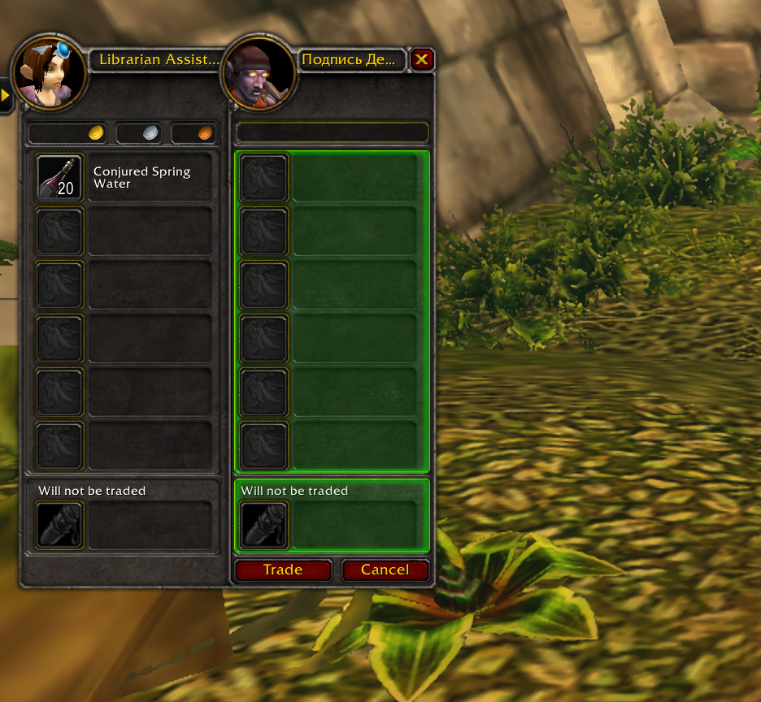

# Waterboy Forever - Mage Toolkit

Mage utilities for WoW Forever (Interface 16001): configurable refreshment trades, a bag-supply overview, and a library of standard mage macros. The expanded toolkit requires live-client validation.

- Adds up to one stack per selected refreshment type.
- Defaults: hunters and warlocks get food and water; warriors and rogues get food only; other classes get water.
- Picks the highest available rank the other player can use.
- Combines matching partial stacks in your bags, up to one full stack per type. If you have less, offers what remains. Does not conjure.
- Set a key under **Key Bindings > Waterboy > Accept trade**, then press it after checking your trade. The other player must also accept. No key is assigned by default.
- Acceptance is manual; existing trade items are left alone. The keybind accepts the current trade just like the Trade button, including any items or money you added yourself.
- `/waterboy trade` opens a Food, Water, or Food and water dropdown for each class and a reset button. Choices are saved per account.
- `/waterboy on` or `/waterboy off` to toggle. `/watertrade` also works.

For WoW Forever, client 1.60.1 (Interface 16001). Enabled by default.

## Installation

Put the `WaterboyForever` folder in `_forever_/Interface/AddOns`.
Remove the older `WaterTradeForever` addon if installed. The saved-variable name is retained for compatibility; when upgrading locally, copy its saved-variable file to `WaterboyForever.lua` while WoW is closed to preserve the toggle.

## Validation

Run `uv run --with lupa python tests/check.py` for offline behavior checks.
Previous full-stack behavior confirmed in-game on 15 October 2026. Partial-stack selection and combining have passed offline checks; live verification after `/reload` is pending. The new class dropdowns and Warlock default have passed offline checks; their in-game rendering, persistence and trades still need verification.

## Limits

Skips combat, busy cursors, unknown players and unusable stacks. Supports Classic conjured food and water item IDs. One offer per trade, with retries for up to ten seconds for item data, bag locks and stack combining.

## Mage toolkit (0.4.0)

Open `/waterboy`, `/waterboy macros`, `/mageboy`, or the Waterboy entry in the game's AddOns options.

- Bag totals for conjured food/water, teleport runes, portal runes and arcane powder; refreshes on bag changes while open. Totals combine all supported Classic ranks, exclude bank stock, and do not assess whether a rank suits your level.
- 34 templates, including utility combinations and basic spell shortcuts: Counterspell, Polymorph, decurse, Intellect, Ice Barrier, Ice Block cast/cancel and optional separate cancellation, Blink, Frost Nova, Evocation, conjuring, Frostbolt, Fireball, Arcane Explosion, armors, Mana Shield, and six cities' teleports and portals.
- Choose target, focus-first or mouseover-first for Counterspell and Polymorph. Focus/mouseover falls back to your target when no living hostile unit matches; it does not fall back for range or line-of-sight failures. Set focus yourself using the game's focus controls.
- Optional friendly mouseover priority for Intellect/decurse, then friendly target, then self. Optional stopcasting on Counterspell (enabled initially).
- Preview the exact localized macro body before creation; select it to copy manually if needed. Character storage is the default; account storage is optional. Preferences are account-wide.
- Click **Create macro**, then open `/macro` and drag the new `WB ...` macro to your action bar. Each cast requires your input. Templates require the relevant learned spell, talents and reagents; both factions' travel templates are listed so choose your own learned destinations.
- Creation is blocked in combat and on non-mages. Existing names in either scope are never overwritten, and full storage is reported. No automatic bar placement, keybinding changes or macro deletion.
- Settings affect previews and future creations, not existing macros. Edit existing macros in `/macro`, or rename/delete one there before creating its replacement. Creating all 34 is unnecessary and may exceed character storage.

Run `uv run --with lupa python tests/mage_check.py` for macro guardrails and mocked UI integration, alongside `tests/check.py` for trade regressions. Offline checks do not establish live rendering, spell execution, localization coverage or saved-setting persistence. After `/reload`, verify those in-game before publication. Research and design notes are in `docs/macro-research.md`.

### Revised utility macros

Ice Block stops casting, cancels an existing block, then casts it. The cancellation comes before the cast, so the first press enters and a later press exits while the spell is on cooldown. Do not spam it if you want to remain protected. Blink and Frost Nova also stop casting and cancel Ice Block before their cast. Polymorph stops autoattack.

Added combined water/food conjuring (Shift or right-click for food), cursor Blizzard, non-toggling wand Shoot, and self Slow Fall with Shift cancellation. Evocation does not restart an active channel. Friendly mouseover defaults on for new preferences; existing selections are preserved. Basic spell and travel shortcuts remain available.

Existing saved macros retain their old text: copy the revised preview into the existing macro in `/macro` to preserve its action-bar placement. These changes require in-game validation on Forever.
