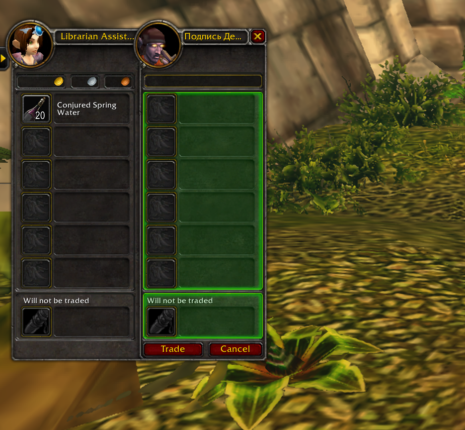

# Waterboy Forever

Automatically adds conjured refreshments to your trade window. Tested in-game and working on WoW Forever beta (1.60.1).

- Adds up to one stack of conjured water to trades with mana classes.
- Hunters get food and water; warriors and rogues get food only.
- Picks the highest available rank the other player can use.
- Combines matching partial stacks in your bags, up to one full stack per type. If you have less, offers what remains. Does not conjure.
- You click Trade to finish. Existing trade items are left alone.
- `/waterboy on` or `/waterboy off` to toggle. `/watertrade` also works.

For WoW Forever beta, client 1.60.1 (Interface 16001). Enabled by default.

## Installation

Put the `WaterboyForever` folder in `_classic_beta_/Interface/AddOns`.
Remove the older `WaterTradeForever` addon if installed. The saved-variable name is retained for compatibility; when upgrading locally, copy its saved-variable file to `WaterboyForever.lua` while WoW is closed to preserve the toggle.

## Validation

Run `uv run --with lupa python tests/check.py` for offline behavior checks.
Previous full-stack behavior confirmed in-game on 15 October 2026. Partial-stack selection and combining have passed offline checks; live verification after `/reload` is pending.

## Limits

Skips combat, busy cursors, unknown players and unusable stacks. Supports Classic conjured food and water item IDs. One offer per trade, with retries for up to ten seconds for item data, bag locks and stack combining.
